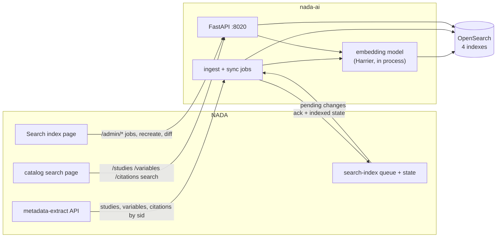
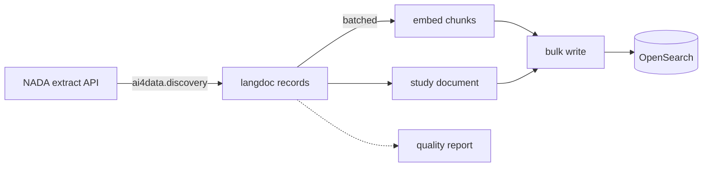

# Architecture

How nada-ai reads a NADA catalog, builds its OpenSearch indexes, keeps them in sync, and answers NADA's searches.

For installing and running it, see the [OpenSearch setup guide](./opensearch-setup-guide.md). For the MCP server, see
the [MCP guide](./mcp.md).

## End to end

- NADA owns the catalog. nada-ai only reads it, always by NADA's internal study id (`sid`).
- NADA records changes in its search-index queue. nada-ai pulls the queue, indexes or deletes, then acknowledges each
  item and reports what it indexed. NADA never pushes to nada-ai.
- NADA's catalog page sends searches to nada-ai and loads the rows of each page from its own database.
- NADA's Search index page drives nada-ai's admin API: full index, per-type jobs, index rebuilds, diff and reconcile.

## The four indexes

All names derive from `NADA_INDEX_NAME` (default `nada-metadata`).

| Index | Holds | Search | Feeds |
|---|---|---|---|
| `nada-metadata` (chunks) | Text chunks of each study with their embedding (`knn_vector`, FAISS HNSW, cosine) | Vector | Semantic and hybrid study search, `/search` |
| `nada-metadata-studies` | One document per study, `_id` = `sid`: title, type, filters, counts, all-text field | Keyword (BM25) | `/studies/search`, facets |
| `nada-metadata-variables` | One document per variable | Keyword only | `/variables/search` |
| `nada-metadata-citations` | One document per citation | Keyword only | `/citations/search` |

Only the chunk index holds embeddings. Rebuilding the study, variable or citation index never re-embeds anything.
With the `local` backend, an unchanged chunk keeps its stored vector when a study is indexed again.

## Ingest

1. `ai4data.discovery` fetches each study's full record from NADA's metadata-extract API by `sid` and turns it into
   searchable text ("langdocs"). Filters come from the same payload.
2. Chunks are embedded in batches and written to the chunk index. The study document goes to the study index.
3. Microdata studies also write their variables. Citations are synced separately.
4. Every document passes a non-blocking quality check.

Jobs run in the API process, one at a time per catalog type, and can be cancelled and resumed. NADA's Search index
page and the admin API start them; the CLI runs the same code in the foreground.

## Keeping in sync

The sync scheduler runs inside the API (`NADA_RECONCILE_SEARCH_INDEX_ENABLED`, on by default). Every few minutes it
reads NADA's queue, indexes or deletes each changed study or citation, acknowledges it, and, with
`NADA_REPORT_SEARCH_INDEX_STATE_ENABLED=true`, reports the result to NADA's search-index state. NADA's Search index page
reads that state to show coverage, errors and what is missing.

`POST /admin/search-index/reconcile-diff` compares NADA's catalog with what is indexed, then indexes what is missing
and deletes what NADA no longer has. Use it after an outage or a restore.

## Study search

`POST /studies/search` serves four modes:

| Mode | When | How |
|---|---|---|
| `browse` | No query | Filters and sort on the study index |
| `lexical` | Keyword search | BM25 on the study index; every match is returned and paged |
| `semantic` | Meaning only | Vector search on the chunk index, collapsed to one hit per study, capped at `NADA_STUDIES_SEMANTIC_WINDOW` |
| `hybrid` | A query with `auto` mode (the default) | The semantic studies fused by rank with the best keyword matches, then the remaining keyword matches |

Facet counts come from a second request on the study index, run next to the page request. Variable and citation search
are keyword only and switch to cursor paging past `max_offset`.

NADA reads which searches nada-ai serves from `GET /info`. See the
[study](./studies-search-contract.md), [variable](./variables-search-contract.md) and
[citation](./citations-search-contract.md) contracts.

## Embeddings

| `NADA_EMBEDDING_BACKEND` | Where the model runs | Notes |
|---|---|---|
| `local` (default) | In the nada-ai process | `microsoft/harrier-oss-v1-270m`, 640 dimensions, multilingual. Downloaded once from Hugging Face, then cached |
| `opensearch_ml` | Inside OpenSearch (ML Commons) | Needs `NADA_OPENSEARCH_ML_MODEL_ID` and the dimension. NADA's study search is keyword only: semantic and hybrid need `local` |
| `none` | Nowhere | Keyword search only; semantic and hybrid are not offered |

The query side uses the same model with a query prompt (`NADA_QUERY_PROMPT_NAME`, default `web_search_query`).
Changing the model means recreating the chunk index and indexing again; `GET /admin/embeddings/drift` detects a
mismatch.

In Docker, the API container mounts the host's Hugging Face cache and runs offline (`HF_HUB_OFFLINE=1`), so download
the model on the host first. See [Download the Harrier model once](./opensearch-setup-guide.md#download-the-harrier-model-once).

## Where the code lives

| Area | Path |
|---|---|
| FastAPI app, admin API, jobs, scheduler | `src/nada_ai/app/` |
| Ingest pipeline and NADA sync | `src/nada_ai/ingest/` |
| OpenSearch mapping, queries, study/variable/citation search | `src/nada_ai/search/backend/opensearch/` |
| Filters and facets | `src/nada_ai/filters/` |
| NADA HTTP client used by the MCP server | `src/nada_ai/nada/` |
| MCP server | `src/nada_ai/mcp_server/` |
